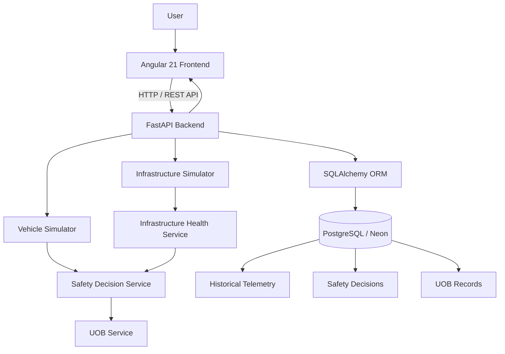

# Smart Infrastructure Intelligence & I2V Safety Platform

A full-stack software prototype for intelligent infrastructure health monitoring, structural-risk assessment, vehicle telemetry analysis, and Infrastructure-to-Vehicle (I2V) safety communication.

The platform simulates infrastructure and vehicle telemetry, evaluates structural health, generates safety recommendations, and persists monitoring data through a RESTful backend.

<p align="center">
  <strong>Angular 21 · FastAPI · PostgreSQL · SQLAlchemy · Python</strong>
</p>

---

## 🚀 Live Application

| Resource | Link |
|---|---|
| Live Frontend | [Open Application](https://infrastructure-health-monitoring-frontend.onrender.com/) |
| Backend API | [FastAPI Backend](https://infrastructure-health-monitoring-api.onrender.com) |
| API Documentation | [Swagger UI](https://infrastructure-health-monitoring-api.onrender.com/docs#/) |
| GitHub Repository | [Source Code](https://github.com/7Jags/infrastructure-health-monitoring) |

*Note: The application is hosted on Render's free tier. Services may take some time to respond after periods of inactivity.*

---

## 📌 Project Overview

Infrastructure monitoring is essential for identifying structural deterioration, detecting potentially unsafe conditions, and supporting preventive maintenance.

This project explores a software-driven approach to infrastructure intelligence by simulating a connected infrastructure monitoring environment.

The platform consists of an Angular dashboard and a FastAPI backend. Virtual infrastructure and vehicle nodes generate telemetry, which is processed by backend services to assess infrastructure health and produce vehicle safety recommendations.

The system also maintains historical telemetry, safety decisions, and Universal Optical Broadcast (UOB) message records.

**Current implementation:** A software-first prototype using simulated telemetry. Physical sensor integration is a potential future enhancement.

---

## ✨ Key Features

### 1. Infrastructure Health Monitoring
- Virtual bridge telemetry generation.
- Structural-health assessment.
- Monitoring of load, vibration, strain, and temperature.
- Infrastructure health categorization.
- Historical infrastructure telemetry storage.

### 2. Vehicle Telemetry Simulation
- Virtual vehicle telemetry generation.
- Multiple simulated vehicle nodes.
- Vehicle-state monitoring.
- Persistent vehicle telemetry records.

### 3. Safety Decision Engine
- Combines infrastructure and vehicle information.
- Evaluates infrastructure-related vehicle safety conditions.
- Generates GREEN, AMBER, and RED safety recommendations.

### 4. Infrastructure-to-Vehicle Communication
- Generates Universal Optical Broadcast (UOB) packets.
- Provides vehicle-specific safety information.
- Exposes the latest simulated I2V message through REST APIs.

### 5. Historical Data Management
- Persistent infrastructure telemetry.
- Vehicle telemetry records.
- Historical safety decisions.
- Historical UOB messages.

### 6. Interactive Dashboard
- Angular-based monitoring interface.
- Dashboard data retrieved through backend APIs.
- Centralized visualization of infrastructure and safety information.

---

## 🏗️ System Architecture



### Application Workflow

1. Infrastructure and vehicle simulators generate virtual telemetry.
2. FastAPI exposes the generated information through REST endpoints.
3. Backend services process telemetry and assess infrastructure health.
4. The safety service combines infrastructure and vehicle information.
5. Safety recommendations and UOB packets are generated.
6. SQLAlchemy persists application records in PostgreSQL.
7. Angular retrieves and presents the information through the dashboard.

---

## 🛠️ Technology Stack

| Category | Technologies |
|---|---|
| Frontend Framework | Angular 21 |
| Programming Languages | Python, TypeScript |
| Frontend Reactive Programming | RxJS |
| Backend Framework | FastAPI |
| API Architecture | REST |
| Database | PostgreSQL |
| Cloud Database | Neon |
| ORM | SQLAlchemy 2.x |
| Database Driver | Psycopg 3 |
| Database Migrations | Alembic |
| Configuration Management | Pydantic Settings |
| Frontend Testing | Vitest |
| Backend Testing | Pytest |
| Deployment | Render |
| Version Control | Git, GitHub |

---

## ⚙️ Backend Architecture

The backend follows a modular structure separating API routing, business logic, database management, and simulation services.

```text
backend/
├── alembic/
│   └── versions/
├── app/
│   ├── routes/
│   │   ├── dashboard.py
│   │   ├── history.py
│   │   ├── infrastructure.py
│   │   ├── safety.py
│   │   ├── uob.py
│   │   └── vehicles.py
│   │
│   ├── services/
│   │   ├── health_service.py
│   │   ├── infrastructure_simulator.py
│   │   ├── infrastructure_state_service.py
│   │   ├── persistence_service.py
│   │   ├── safety_service.py
│   │   ├── simulation_service.py
│   │   ├── uob_service.py
│   │   └── vehicle_simulator.py
│   │
│   ├── config.py
│   ├── database.py
│   ├── main.py
│   ├── models.py
│   └── schemas.py
│
├── tests/
├── alembic.ini
├── pytest.ini
└── requirements.txt
```

### Architectural Responsibilities

- **Routes:** Define API endpoints and handle incoming requests.
- **Services:** Implement simulation, health assessment, persistence, and safety logic.
- **Models:** Define database entities using SQLAlchemy.
- **Schemas:** Define API data structures and validation.
- **Database:** Manage PostgreSQL connections and database sessions.
- **Alembic:** Manage version-controlled database schema migrations.

---

## 🖥️ Frontend Architecture

The Angular application separates dashboard components from API communication services.

```text
frontend/
└── src/
    └── app/
        ├── core/
        │   └── services/
        │       ├── dashboard.ts
        │       ├── history.ts
        │       ├── infrastructure.ts
        │       ├── safety.ts
        │       ├── uob.ts
        │       └── vehicle.ts
        │
        ├── features/
        │   └── dashboard/
        │       ├── dashboard.ts
        │       ├── dashboard.html
        │       └── dashboard.css
        │
        ├── app.config.ts
        ├── app.routes.ts
        ├── app.ts
        ├── app.html
        └── app.css
```

### Frontend Responsibilities

- Dashboard presentation and data visualization.
- API communication through Angular services.
- Environment-based backend URL configuration.
- Client-side application routing.
- Reactive data handling using RxJS.

---

## 🔌 API Endpoints

The backend exposes REST APIs through FastAPI.

| Method | Endpoint | Description |
|---|---|---|
| GET | `/api/health` | API health check |
| GET | `/api/dashboard` | Dashboard data |
| GET | `/api/infrastructure/bridges/BR-001/state` | Current infrastructure state |
| POST | `/api/infrastructure/simulation/reset` | Reset infrastructure simulation |
| GET | `/api/vehicles/{vehicle_id}/state` | Retrieve vehicle telemetry |
| GET | `/api/safety/vehicles/{vehicle_id}/decision` | Retrieve vehicle safety recommendation |
| GET | `/api/uob/vehicles/{vehicle_id}/latest` | Retrieve latest UOB packet |
| GET | `/api/history/infrastructure/{node_id}` | Infrastructure telemetry history |
| GET | `/api/history/vehicles/{vehicle_id}` | Vehicle telemetry history |
| GET | `/api/history/safety/vehicles/{vehicle_id}` | Historical safety decisions |
| GET | `/api/history/uob/vehicles/{vehicle_id}` | Historical UOB packets |

For the complete interactive API reference, visit:

[FastAPI Swagger Documentation](https://infrastructure-health-monitoring-api.onrender.com/docs)

---

## 🗄️ Database and Persistence

The application uses PostgreSQL for persistent data storage.

### Database Technologies

- PostgreSQL for relational data storage.
- SQLAlchemy for ORM-based database operations.
- Psycopg 3 for PostgreSQL connectivity.
- Alembic for schema versioning and migrations.
- Neon for cloud-hosted PostgreSQL.

### Database Configuration

Database settings are managed through Pydantic Settings and environment variables.

The application supports configurable database hostname, port, username, password, database name, and SSL mode.

Alembic uses the same database engine and model metadata as the FastAPI application.

---

## 💻 Local Installation and Setup

### Prerequisites

Install the following:

- Python 3.11 or later.
- Node.js and npm.
- PostgreSQL.
- Git.

### 1. Clone the Repository

```bash
git clone https://github.com/7Jags/infrastructure-health-monitoring.git

cd infrastructure-health-monitoring
```

If you want the latest development branch:

```bash
git checkout feature/angular-dashboard
```

### 2. Configure the Backend

Navigate to the backend directory:

```bash
cd backend
```

Create a virtual environment:

```bash
python3 -m venv .venv
```

Activate it:

**macOS / Linux**

```bash
source .venv/bin/activate
```

**Windows**

```powershell
.venv\Scripts\activate
```

Install dependencies:

```bash
pip install -r requirements.txt
```

### 3. Configure Environment Variables

From the project root, copy the example configuration:

```bash
cp .env.example backend/.env
```

Edit `backend/.env` with your PostgreSQL credentials:

```env
DATABASE_HOSTNAME=localhost
DATABASE_PORT=5433
DATABASE_USERNAME=project1_user
DATABASE_PASSWORD=your_password_here
DATABASE_NAME=Project1
DATABASE_SSLMODE=prefer
```

Make sure the PostgreSQL database and user exist before starting the application.

For Neon, configure the corresponding cloud database credentials and use:

```env
DATABASE_SSLMODE=require
```

Never commit your actual `.env` file or database credentials.

### 4. Run Database Migrations

From the backend directory, with the virtual environment activated:

```bash
alembic upgrade head
```

This applies the available database migrations.

### 5. Start the Backend

```bash
uvicorn app.main:app --reload
```

Backend API:

```text
http://127.0.0.1:8000
```

Interactive API documentation:

```text
http://127.0.0.1:8000/docs
```

### 6. Start the Frontend

Open another terminal:

```bash
cd frontend
```

Install dependencies:

```bash
npm ci
```

Start the Angular development server:

```bash
npm start
```

Open:

```text
http://localhost:4200
```

The development environment is configured to communicate with the local FastAPI backend.

---

## 🧪 Testing

### Backend Tests

Navigate to the backend directory:

```bash
cd backend
```

Run:

```bash
python -m pytest -v
```

### Frontend Tests

Navigate to the frontend directory:

```bash
cd frontend
```

Run:

```bash
npm test
```

### Production Build

To verify the Angular production build:

```bash
npm run build
```

---

## ☁️ Deployment

The application uses separate deployment services.

| Component | Hosting |
|---|---|
| Angular Frontend | Render Static Site |
| FastAPI Backend | Render Web Service |
| PostgreSQL Database | Neon |

### Frontend Production Configuration

The production Angular environment points to the deployed FastAPI backend:

```typescript
export const environment = {
  production: true,
  apiUrl: 'https://infrastructure-health-monitoring-api.onrender.com'
};
```

### Backend Deployment

The backend runs using:

```bash
uvicorn app.main:app --host 0.0.0.0 --port $PORT
```

The backend uses environment variables configured in Render to connect to Neon PostgreSQL.

---

## 🔮 Future Enhancements

Potential directions for extending the prototype include:

- Integration with physical IoT sensors.
- Real-time telemetry ingestion.
- Advanced structural-health prediction using machine learning.
- Historical trend analysis and anomaly detection.
- More sophisticated infrastructure risk assessment.
- Real-world I2V communication hardware integration.
- Authentication and role-based access control.
- Expanded monitoring and analytics capabilities.

---

## 👨‍💻 Project Information

**Project:** Smart Infrastructure Intelligence & I2V Safety Platform

**Repository:** [GitHub](https://github.com/7Jags/infrastructure-health-monitoring)

**Live Demo:** [Open Application](https://infrastructure-health-monitoring-frontend.onrender.com/)

**Backend:** [FastAPI](https://infrastructure-health-monitoring-api.onrender.com)

**API Documentation:** [Swagger UI](https://infrastructure-health-monitoring-api.onrender.com/docs)

---

*This project is a software-first prototype demonstrating full-stack application development, backend architecture, telemetry simulation, database persistence, and infrastructure-to-vehicle safety concepts.*